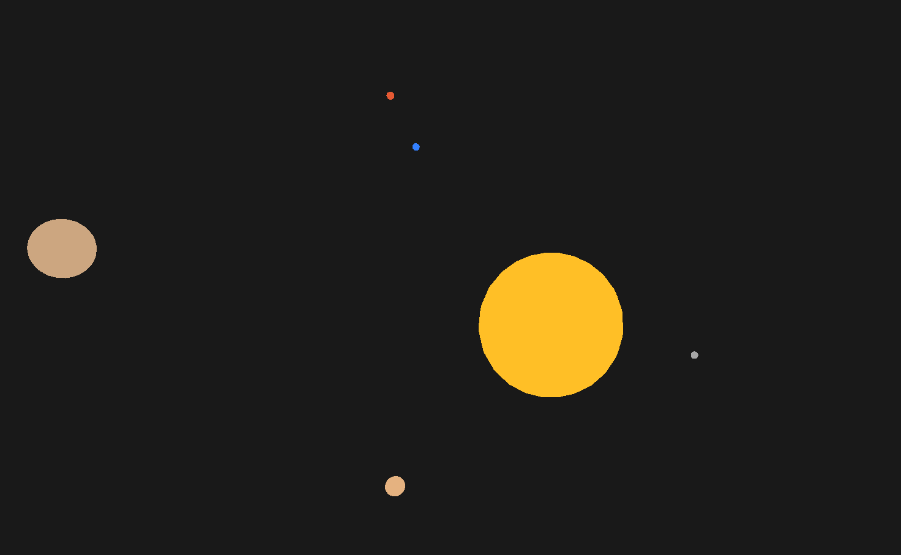
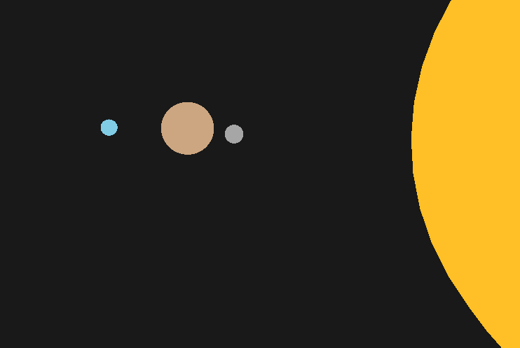

# 3D Solar System Simulation

A simple 3D solar system simulation built using C++ and OpenGL.

## Screenshots

### Solar System Overview


### Planetary Orbits


## Overview

This project visualizes the Sun and planets in a 3D environment. It uses mathematical transformations and trigonometric functions to simulate planetary rotation and revolution.

The simulation focuses on visual representation rather than physically accurate orbital mechanics. Planetary movement is calculated using sine and cosine functions, without gravitational calculations.

## Features

- Procedurally generated 3D spheres.
- Multiple planets with individual sizes and colours.
- Mathematical orbital movement using sine and cosine.
- Independent orbital and rotational speeds.
- 3D camera controls.
- Real-time rendering using OpenGL.

## Technologies Used

- C++
- OpenGL 3.3 Core
- GLFW
- GLAD
- GLM

## How It Works

Planetary positions are calculated using trigonometric functions:

```cpp
x = radius * cos(angle);
z = radius * sin(angle);
```

The angle is updated over time using angular velocity and frame delta time.

Each planet shares the same sphere mesh, with individual model matrices controlling its position and scale.

## Project Scope

This is an educational graphics programming project intended to explore:

- 3D coordinate systems
- Spherical geometry
- Model transformations
- Trigonometry
- Procedural mesh generation
- Real-time rendering

The simulation does not implement gravitational physics or physically accurate orbital mechanics.

## Status

Currently in development.
